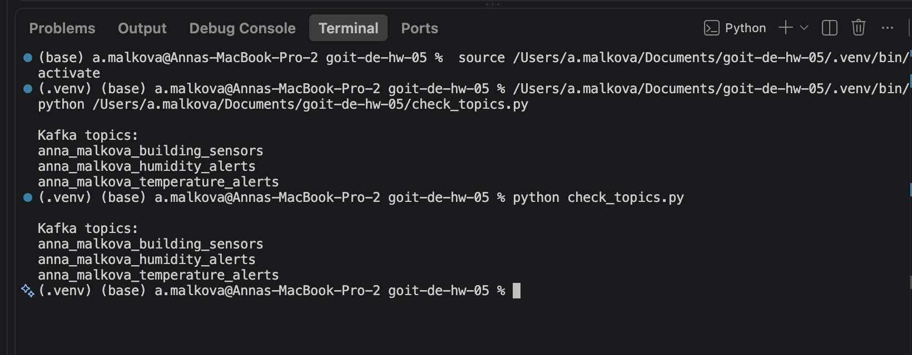
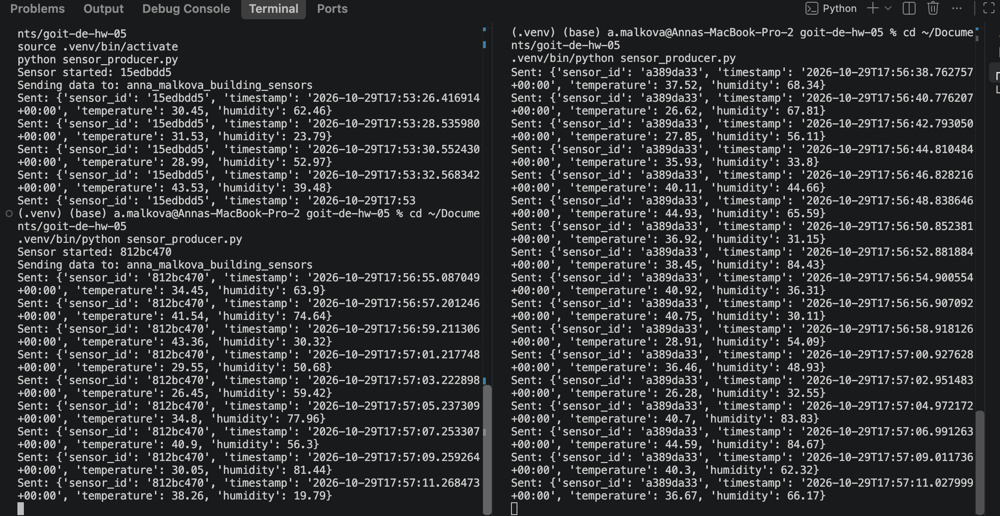
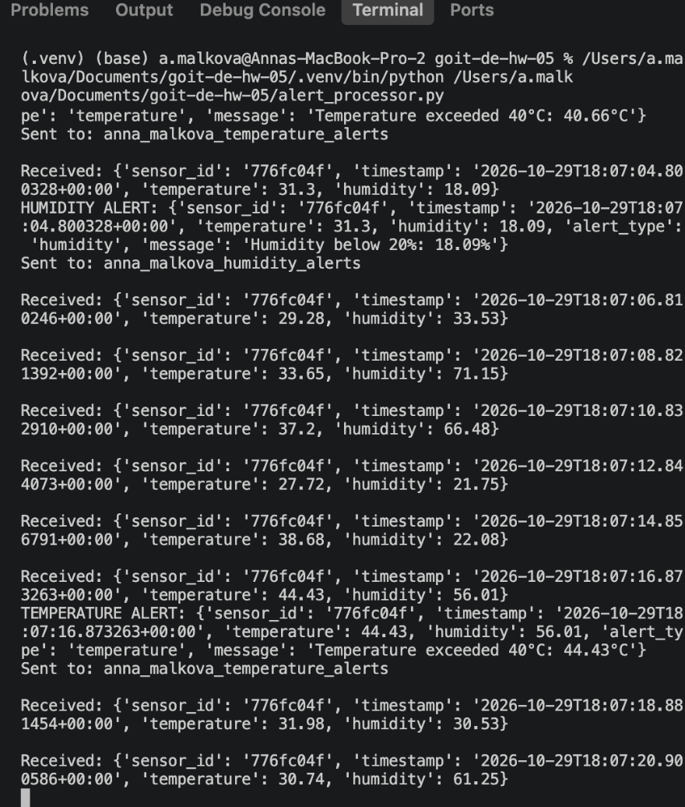
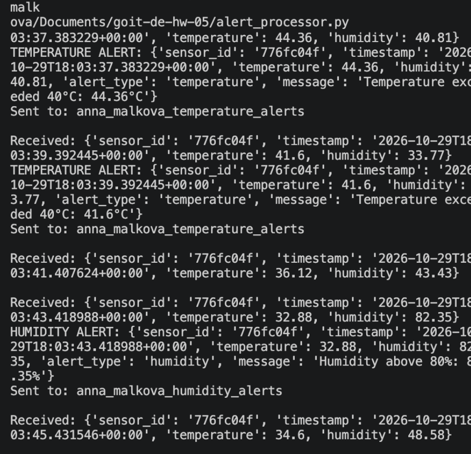
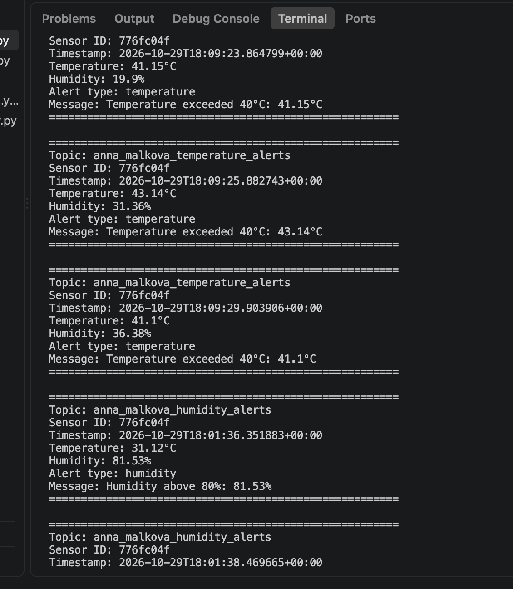

cd ~/Documents/goit-de-hw-05

cat > README.md <<'EOF'
# Домашнє завдання №5 — Apache Kafka

## Мета

Реалізувати потокову обробку даних IoT-датчиків за допомогою Apache Kafka: генерацію показників температури та вологості, фільтрацію за визначеними порогами, публікацію сповіщень і зчитування результатів.

## Технології

- Python 3.13
- Apache Kafka 4.1.2
- Docker Compose
- kafka-python 3.0.12

## 1. Створення Kafka-топіків

Створено три топіки з унікальним префіксом `anna_malkova`:

- `anna_malkova_building_sensors` — вхідні дані датчиків.
- `anna_malkova_temperature_alerts` — температурні сповіщення.
- `anna_malkova_humidity_alerts` — сповіщення про вологість.

Наявність топіків перевірено через `KafkaAdminClient.list_topics()` у `check_topics.py`.



## 2. Генерація даних IoT-датчиків

Скрипт `sensor_producer.py` імітує роботу окремого датчика.

Кожен запуск отримує власний `sensor_id`, який залишається незмінним протягом роботи програми.

Кожні дві секунди генерується повідомлення з такими полями:

- `sensor_id` — ідентифікатор датчика.
- `timestamp` — час вимірювання.
- `temperature` — випадкова температура від 25 до 45 °C.
- `humidity` — випадкова вологість від 15 до 85%.

Дані надсилаються у топік `anna_malkova_building_sensors`.

Для перевірки паралельної роботи запущено два екземпляри `sensor_producer.py` з різними ідентифікаторами.



## 3. Отримання та фільтрація даних

Скрипт `alert_processor.py` зчитує повідомлення з топіка `anna_malkova_building_sensors` та перевіряє кожне вимірювання.

Умови формування сповіщень:

- Температура понад 40 °C.
- Вологість понад 80%.
- Вологість нижче 20%.

Вимірювання, які не відповідають жодній із цих умов, не створюють сповіщень.

У терміналі відображаються отримані повідомлення (`Received`) і результати фільтрації (`TEMPERATURE ALERT`, `HUMIDITY ALERT`).



## 4. Публікація сповіщень у Kafka

Відфільтровані повідомлення надсилаються у відповідні топіки:

- `anna_malkova_temperature_alerts` — якщо температура перевищує 40 °C.
- `anna_malkova_humidity_alerts` — якщо вологість виходить за межі 20–80%.

Кожне сповіщення містить:

- Ідентифікатор датчика.
- Час вимірювання.
- Температуру та вологість.
- Тип сповіщення.
- Текст причини спрацювання.

У логах `alert_processor.py` підтверджено відправлення повідомлень до обох вихідних топіків (`Sent to`).



## 5. Зчитування та відображення сповіщень

Скрипт `alert_consumer.py` підписується на два топіки:

- `anna_malkova_temperature_alerts`
- `anna_malkova_humidity_alerts`

Для кожного отриманого повідомлення виводяться назва топіка, `sensor_id`, час, температура, вологість, тип сповіщення та його опис.

Перевірено отримання і температурних сповіщень, і сповіщень про вологість.



## Запуск проєкту

### 1. Запуск Kafka

```bash
docker compose up -d